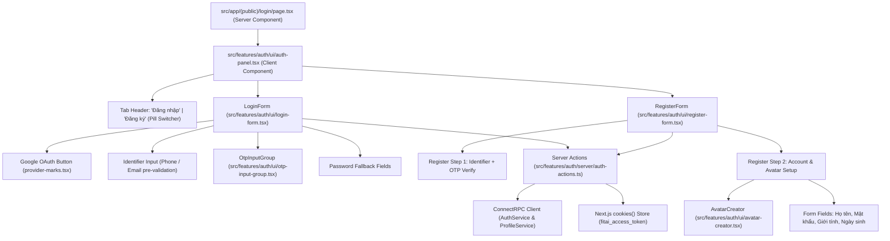

# High-Level Architecture Design: Phone Number & Gmail Auth with Multiavatar

**Feature ID**: `FEAT-AUTH-01`  
**Status**: APPROVED DESIGN  
**Spec Reference**: [01-spec.md](file:///e:/LEARN/a/fitai-web/docs/features/auth-phone-google/01-spec.md)  
**Style Constraints**: **NO ICONS** (không dùng icon, dùng typography, badge, pill và micro-interactions chuyên nghiệp, năng động), **Zero-useEffect**, **ConnectRPC Wire Authority**, **Tokens from DESIGN.md**.

---

## 1. System Architecture & Component Tree



---

## 2. Design Philosophy: "No Icons", Professional & Dynamic

Theo yêu cầu thiết kế không dùng icon biểu tượng, giao diện định hình phong cách **Typography-Driven & Material Surface** (sử dụng chữ, tỉ lệ không gian, viền kính và viền màu năng động của `DESIGN.md`):

1. **Pill Tab Switcher**:
   - 2 nút bấm dạng viên thuốc mềm mại: `Đăng nhập` và `Đăng ký`.
   - Active state: background `var(--color-primary)` (Emerald `#10b981`), chữ đậm trắng, bóng đổ nhẹ.
   - Inactive state: chữ `var(--color-text-muted)`, hover làm sáng nhẹ viền.
2. **Nút bấm & Hành động bằng Text rõ ràng**:
   - Thay vì icon mắt ẩn/hiện mật khẩu: Dùng text link `Hiện` / `Ẩn` đặt gọn trong input.
   - Thay vì icon xúc xắc: Dùng nút pill nhỏ `Đổi mẫu avatar` với hiệu ứng hover màu chuyển động.
   - Thay vì icon máy ảnh: Dùng nút text `Tải ảnh cá nhân`.
   - Nút `Sửa số` dạng text link nhỏ bên cạnh số điện thoại bị che `+84 912 ••• 678`.
3. **Smart Email Shortcuts**:
   - Nút pill nổi bật với nhãn rõ ràng: `Mở hộp thư Gmail` hoặc `Mở hộp thư Outlook`.

---

## 3. Component Specifications

### 3.1 `AuthPanel` (`src/features/auth/ui/auth-panel.tsx`)

- Quản lý trạng thái tab hiện tại: `"login"` hoặc `"register"`.
- Bọc toàn bộ trong glassmorphism surface theo `DESIGN.md` (`login-form-panel`).
- Xử lý chuyển cảnh mượt mà giữa các bước.

### 3.2 `LoginForm` (`src/features/auth/ui/login-form.tsx`)

- Quản lý 3 trạng thái con (sub-states):
  - `IDENTIFIER_INPUT`: Ô nhập SĐT/Email + nút Google + nút chuyển sang Mật khẩu.
  - `OTP_VERIFY`: 6 ô pin OTP + bộ đếm ngược 60s + nút gửi lại + nút shortcut mở Gmail/Outlook.
  - `PASSWORD_LOGIN`: Ô nhập SĐT/Email + Mật khẩu + link Quên mật khẩu.

### 3.3 `RegisterForm` (`src/features/auth/ui/register-form.tsx`)

- Quản lý 2 bước đăng ký:
  - `STEP_VERIFY`: Nhập SĐT/Email $\rightarrow$ Gửi & Xác thực OTP `purpose: "register"`.
  - `STEP_PROFILE`: Điền thông tin cá nhân kèm chọn/sinh Avatar.
- Gọi Server Action `registerAction` $\rightarrow$ Tự động lưu cookie $\rightarrow$ chuyển hướng sang `/onboarding`.

### 3.4 `AvatarCreator` (`src/features/auth/ui/avatar-creator.tsx`)

- **Tích hợp `@multiavatar/multiavatar`**:
  - Khi user gõ `fullName`, hook `useMultiavatar(fullName)` tính toán chuỗi SVG tức thì.
  - Khung tròn `96x96px`, viền `2px solid var(--color-primary)`, bo tròn `9999px`.
- **Chế độ Chọn / Tải ảnh**:
  - `Mode: GENERATED` (mặc định): Hiển thị SVG Multiavatar.
  - `Mode: CUSTOM_UPLOAD`: Hiển thị ảnh tải lên từ máy (`FileReader.readAsDataURL`).
- **Thao tác bằng văn bản (No Icons)**:
  - Nút chữ `Đổi mẫu ngẫu nhiên`: Tạo seed mới khi bấm.
  - Nút chữ `Tải ảnh từ máy`: Kích hoạt `<input type="file" accept="image/*" />` ngầm.
  - Hàng 4 avatar mẫu nhỏ (`36x36px`) để click chọn nhanh kiểu dáng.

### 3.5 `OtpInputGroup` (`src/features/auth/ui/otp-input-group.tsx`)

- 6 ô `input` riêng biệt:
  - Kích thước `48x56px`, bo góc `var(--radius-md)`.
  - Chữ số hiển thị to, đậm (`font-size: 1.5rem`), căn giữa.
  - Viền sáng Emerald khi focus (`border-color: var(--color-primary)`).
  - Tự động nhảy ô kế tiếp khi nhập số, lùi về ô trước khi bấm `Backspace`.
  - Hỗ trợ sự kiện `onPaste`: Tự động cắt chuỗi 6 ký tự số và điền vào cả 6 ô, sau đó tự động gọi `onComplete(code)`.

---

## 4. Server Actions & Wire Authority (`src/features/auth/server/auth-actions.ts`)

Toàn bộ kết nối backend tuân thủ nguyên tắc **ConnectRPC First** và **Next.js Server Actions**:

```typescript
export type AuthActionResult<T = void> =
  { success: true; data: T } | { success: false; error: string; code?: string };

// 1. Gửi OTP
export async function sendOtpAction(
  identifier: string,
  purpose: "login" | "register",
): Promise<AuthActionResult<{ otpToken: string; expiresInSeconds: number }>>;

// 2. Xác thực OTP
export async function verifyOtpAction(
  otpToken: string,
  code: string,
): Promise<AuthActionResult<{ valid: boolean; resetToken?: string }>>;

// 3. Đăng nhập bằng Mật khẩu
export async function loginWithPasswordAction(
  identifier: string,
  password: string,
): Promise<AuthActionResult<{ redirectUrl: string }>>;

// 4. Đăng ký tài khoản
export async function registerAction(payload: {
  identifier: string;
  password: string;
  fullName: string;
  gender: string;
  dateOfBirth: string;
  avatarUrl?: string;
}): Promise<AuthActionResult<{ redirectUrl: string }>>;
```

---

## 5. Security & Session Handling

- Khi nhận được `accessToken` và `refreshToken` từ backend:
  - Lưu vào cookie HTTP-only thông qua helper `createAuthCookieOptions()` có sẵn trong `@/shared/auth/cookies`.
  - Tuyệt đối không lưu token vào `localStorage` hay biến global window.
- Chống brute-force:
  - Nếu nhập sai mã OTP 3 lần: Giao diện chuyển sang trạng thái Lockout 15 phút kèm bộ đếm thời gian.

---

## 6. Verification & Quality Gates

1. **Skill Guard (`pnpm audit:skills`)**:
   - Không dùng `useEffect` để tính toán derived state hoặc xử lý form submit.
   - Không chứa hardcoded hex color; toàn bộ màu dùng biến CSS token từ [DESIGN.md](file:///e:/LEARN/a/fitai-web/DESIGN.md).
2. **Comment Guard (`pnpm audit:comments`)**:
   - Zero verbose comment; code tự giải thích rõ ràng.
3. **Tests (`pnpm test`)**:
   - Unit test cho OTP keyboard navigation và paste behavior.
   - Unit test cho phone number & email pre-validation.
   - Unit test cho Multiavatar state generation.
   - Unit test cho Server Actions error handling.
