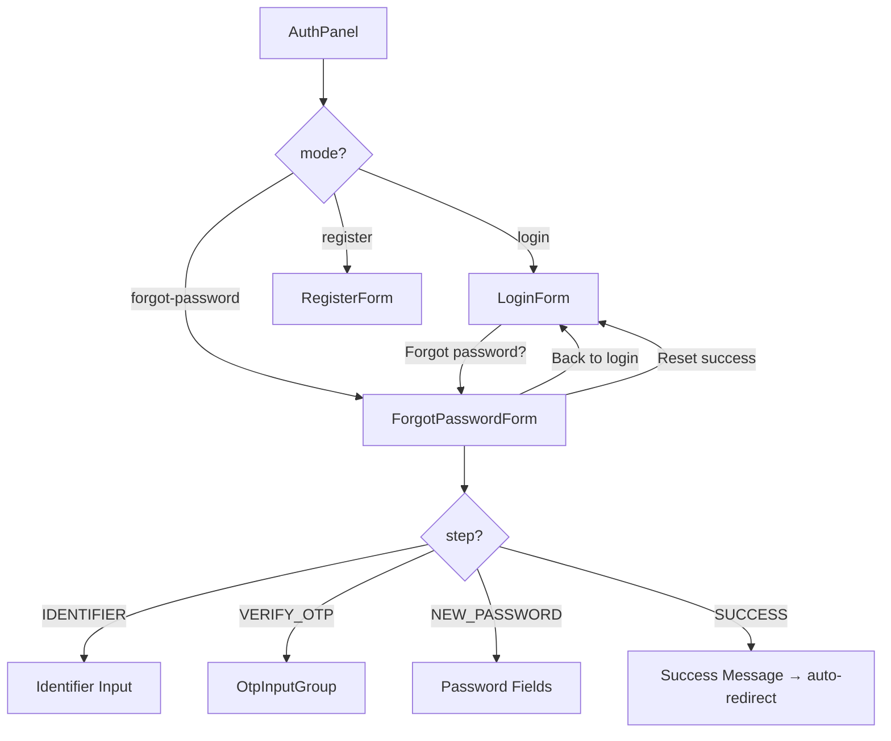
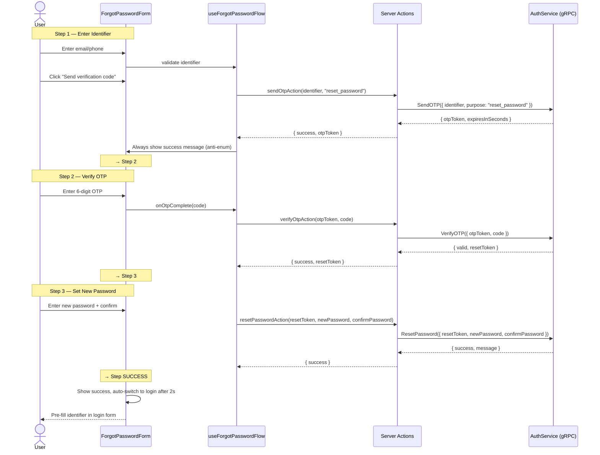
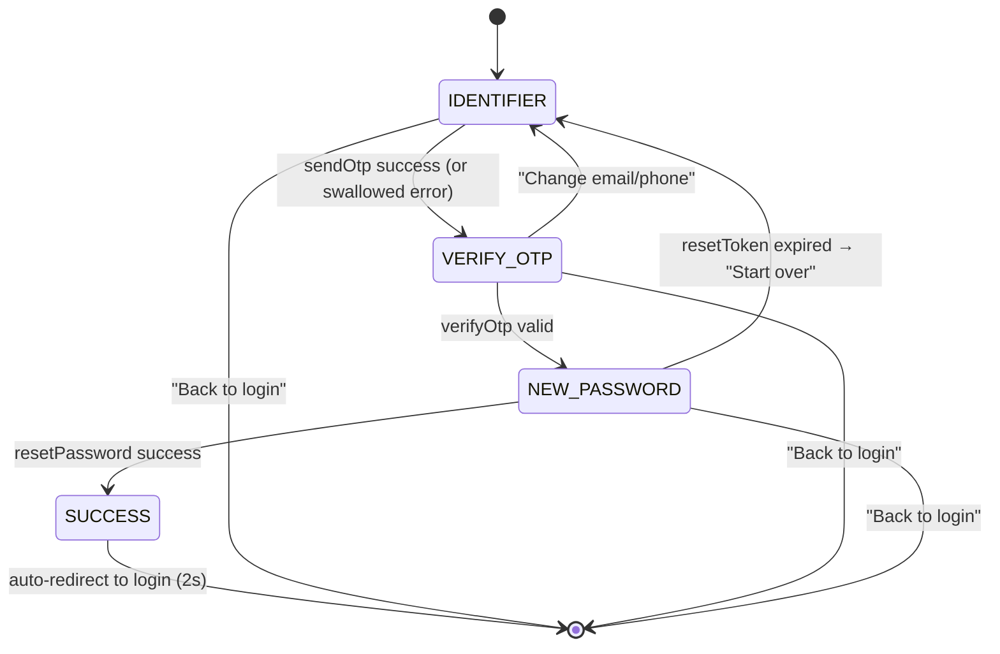

# Forgot Password — Technical Design

> References: [01-spec.md](./01-spec.md) · [ADR-0001](./adr/ADR-0001-authpanel-mode.md)

## 1. System & Component Architecture

### Component Tree

```
AuthPanel (mode: "login" | "register" | "forgot-password")
├── LoginForm           ← mode === "login"
├── RegisterForm        ← mode === "register"
└── ForgotPasswordForm  ← mode === "forgot-password"
     ├── Step IDENTIFIER: identifier input + send OTP
     ├── Step VERIFY_OTP: OtpInputGroup (reused)
     └── Step NEW_PASSWORD: password + confirm fields
```

### Architecture Diagram



### Affected Modules

| Module | Change |
|--------|--------|
| `src/features/auth/ui/auth-panel.tsx` | Add `"forgot-password"` to `AuthMode`, render `ForgotPasswordForm` |
| `src/features/auth/ui/login-form.tsx` | Replace `alert()` with `onForgotPassword` callback |
| `src/features/auth/ui/forgot-password-form.tsx` | **NEW** — 3-step form component |
| `src/features/auth/model/use-forgot-password-flow.ts` | **NEW** — step state machine hook |
| `src/features/auth/server/auth-actions.ts` | Extend `sendOtpAction` purpose + add `resetPasswordAction` |
| `src/app/globals.css` | Minor additions for success state styling |

### Reused Components (zero changes needed)

| Component/Utility | From |
|-------------------|------|
| `OtpInputGroup` | `src/features/auth/ui/otp-input-group.tsx` |
| `useOtpCountdown` | `src/features/auth/model/use-otp-countdown.ts` |
| `detectIdentifierType`, `maskIdentifier`, `normalizePhoneNumber`, `getEmailProviderUrl` | `src/features/auth/model/auth-validation.ts` |
| `Button` (with `loading` prop) | `src/shared/ui/button.tsx` |
| Auth CSS classes (`.auth-field`, `.auth-input`, `.auth-submit-btn`, etc.) | `src/app/globals.css` |

## 2. Execution Flow & Contracts

### Sequence Diagram



### Server Actions Contract

#### `sendOtpAction` (MODIFY — extend purpose type)

```ts
// Current: purpose: "login" | "register"
// New:     purpose: "login" | "register" | "reset_password"
export async function sendOtpAction(
  identifier: string,
  purpose: "login" | "register" | "reset_password"
): Promise<ActionResult<{ otpToken: string; expiresInSeconds: number }>>
```

#### `resetPasswordAction` (NEW)

```ts
export async function resetPasswordAction(
  resetToken: string,
  newPassword: string,
  confirmPassword: string
): Promise<ActionResult<{ success: boolean; message: string }>>
```

- No auth token required (user is not logged in).
- Uses `createServerTransport()` without access token.
- Validates `newPassword.length >= 8` and `newPassword === confirmPassword` server-side before RPC call.

## 3. State Machine — `useForgotPasswordFlow`



### Hook Interface

```ts
type ForgotPasswordStep = "IDENTIFIER" | "VERIFY_OTP" | "NEW_PASSWORD" | "SUCCESS";

interface UseForgotPasswordFlow {
  step: ForgotPasswordStep;
  identifier: string;
  maskedIdentifier: string;
  identifierType: "phone" | "email" | "invalid";
  isLoading: boolean;
  error: string | null;
  otpToken: string | null;
  emailProviderUrl: string | null;

  setIdentifier: (value: string) => void;
  handleSendOtp: () => Promise<void>;
  handleVerifyOtp: (code: string) => Promise<void>;
  handleResetPassword: (newPassword: string, confirmPassword: string) => Promise<void>;
  handleResendOtp: () => Promise<void>;
  goToIdentifierStep: () => void;
  reset: () => void;
}
```

Key design decisions:
- **No `useEffect`** — all state transitions happen in event handlers.
- **`identifier` stays in hook state** — passed back to `AuthPanel` on success for pre-fill.
- **Error state is per-action** — cleared on next action attempt.
- **Anti-enumeration**: `handleSendOtp` always transitions to `VERIFY_OTP`, swallows "not found" errors from backend.

## 4. Error Handling

| Error Source | Handling |
|--------------|----------|
| Network failure / 500 on sendOtp | Show generic "Something went wrong. Please try again." Stay on current step. |
| Backend says identifier not found (sendOtp) | **Swallow** — show success message anyway, transition to OTP step (anti-enumeration). |
| Invalid OTP code | Show "Invalid verification code" inline. Stay on OTP step. |
| OTP expired | Show "Verification code has expired". Allow resend. |
| Reset token expired | Show "Reset session has expired. Please start over." + "Start over" button → IDENTIFIER step. |
| Password too short | Client-side validation before API call. |
| Password mismatch | Client-side validation before API call. |
| Generic backend error on resetPassword | Show `response.message` or fallback generic message. |

## 5. UI Layout

Each step reuses existing `.auth-*` CSS classes. No new design tokens needed.

### Step 1: IDENTIFIER
- Heading: "Reset password"
- Subheading: None (clean, no redundant instruction)
- Input: `.auth-input` with identifier validation
- Primary button: "Send verification code" (`.auth-submit-btn--primary`)
- Footer link: "Back to login" (`.auth-switch-link`)

### Step 2: VERIFY_OTP
- Heading: "Enter verification code"
- Masked identifier badge (reuse RegisterForm pattern)
- `OtpInputGroup` component (reused as-is)
- Email provider shortcut button (if email)
- Footer: "Change email/phone" + "Back to login"

### Step 3: NEW_PASSWORD
- Heading: "Set new password"
- Two password fields with show/hide toggles (Eye/EyeOff pattern from LoginForm)
- Validation hints below each field
- Primary button: "Reset password"
- Footer link: "Back to login"

### Step 4: SUCCESS
- Checkmark icon
- Heading: "Password reset successful"
- Subheading: "You can now sign in with your new password."
- Auto-redirect countdown: "Redirecting to login in 2s..."
- Fallback link: "Back to login" (immediate)
