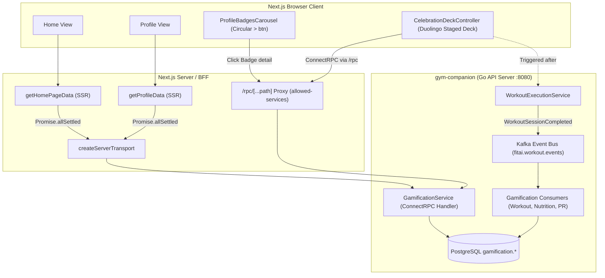
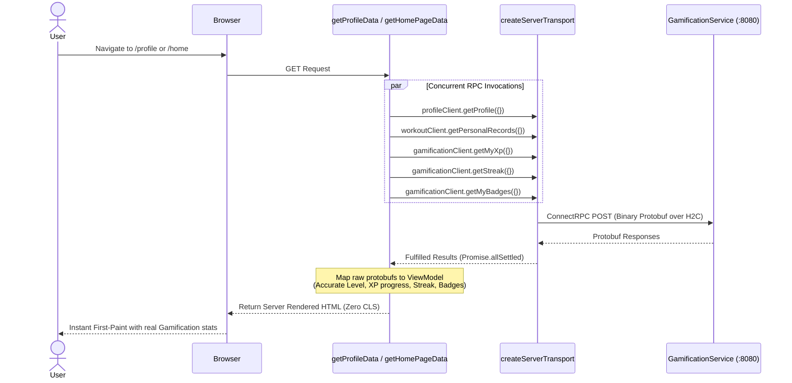
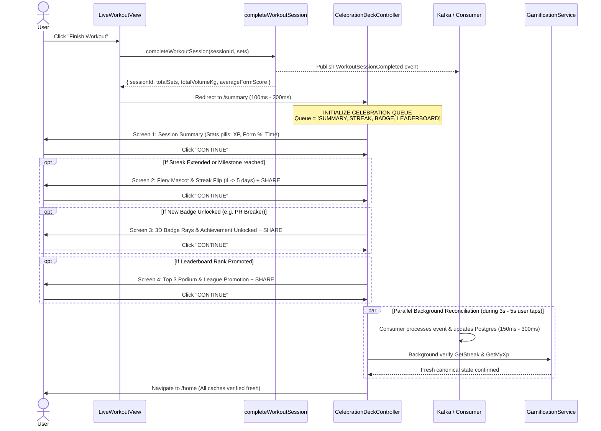

# Gamification Front-End Integration — Technical Design

> References: [01-spec.md](./01-spec.md) · [ADR-0001 (Hybrid Transport)](./adr/ADR-0001-hybrid-gamification-transport.md) · [ADR-0002 (Animation Buffer)](./adr/ADR-0002-post-workout-animation-buffer.md)

---

## 1. System & Component Architecture

### 1.1. Component Tree

```
src/app/(main)/home/page.tsx
└── TodayHeader
     └── TodayStreakBadge (Updated: consumes canonical streak + isActiveToday)

src/app/(main)/profile/page.tsx
└── ProfileContent
     ├── ProfileHeroCard (Updated: level, XP Progress Bar, longest streak)
     ├── ProfileBadgesCarousel (NEW: horizontal snap-x scroll, locked/unlocked, circular > button)
     │    └── BadgeDetailModal (NEW: modal dialog when clicking any badge)
     ├── ProfileHighlightCards
     └── ProfileMenuList

src/app/(workout)/workouts/live/[sessionId]/summary/page.tsx
└── WorkoutSummaryView
     └── CelebrationDeckController (NEW: multi-stage Duolingo modal flow)
          ├── Step 1: BaseSessionSummaryCard (XP, Form Accuracy, Duration/Volume)
          ├── Step 2: StreakMilestoneCard (Conditional: Fiery Mascot, large flip counter, Share)
          ├── Step 3: BadgeUnlockedCard (Conditional: 3D Badge rays, PR Breaker / Streak unlock)
          └── Step 4: LeaderboardPromotionCard (Conditional: Top 3 Podium, percentile rank)
```

### 1.2. Architecture Diagram



### 1.3. Affected Modules & File Changes

| File Path                                                     | Nature     | Description                                                                                        |
| :------------------------------------------------------------ | :--------- | :------------------------------------------------------------------------------------------------- |
| `src/shared/api/bff/allowed-services.ts`                      | **Modify** | Add `contracts.supporting.gamification.v1.service.GamificationService`.                            |
| `tests/unit/allowed-services.test.ts`                         | **Modify** | Add unit test verifying `GamificationService` whitelist.                                           |
| `src/features/home/server/get-home-page-data.ts`              | **Modify** | Call `GamificationService.GetStreak`, delete `calculateConsecutiveStreakDays`.                     |
| `src/features/home/model/home-page.types.ts`                  | **Modify** | Update `StreakInfo` with `longestStreak` and `isActiveToday`.                                      |
| `src/features/home/ui/today-header.tsx`                       | **Modify** | Render flame effect matching `isActiveToday`.                                                      |
| `src/features/profile/server/get-profile-data.ts`             | **Modify** | Fetch `GetMyXp`, `GetStreak`, `GetMyBadges`. Remove `Math.floor(totalWorkouts/4)`.                 |
| `src/features/profile/model/profile.types.ts`                 | **Modify** | Expand ViewModel: `xp`, `xpToNextLevel`, `levelProgressPercentage`, `badges`, `longestStreakDays`. |
| `src/features/profile/model/profile.mapper.ts`                | **Modify** | Map `UserXpSummary`, `StreakSummary`, and `repeated BadgeItem` to ViewModel.                       |
| `src/features/profile/components/profile-hero-card.tsx`       | **Modify** | Add Level XP progress bar and Longest Streak display.                                              |
| `src/features/profile/components/profile-badges-carousel.tsx` | **NEW**    | Horizontal badge carousel, circular `>` scroll button, locked/unlocked states.                     |
| `src/features/profile/components/badge-detail-modal.tsx`      | **NEW**    | Modal displaying full badge criteria, unlocked date, and icons.                                    |
| `src/features/profile/components/profile-content.tsx`         | **Modify** | Mount `ProfileBadgesCarousel` directly below `ProfileHeroCard`.                                    |
| `src/features/workout/ui/live/celebration-deck.tsx`           | **NEW**    | Duolingo-style multi-screen staged modal flow (`Summary → Streak → Badge → Leaderboard`).          |
| `src/features/workout/ui/live/workout-summary-view.tsx`       | **Modify** | Mount `CelebrationDeck` and trigger background revalidation.                                       |

---

## 2. Execution Flow & Contracts

### 2.1. Sequence Diagram: SSR Hydration (Home & Profile)



### 2.2. Sequence Diagram: Duolingo Staged Celebration Deck Flow



---

## 3. Data Models & ViewModels

### 3.1. Profile ViewModel Expansion (`src/features/profile/model/profile.types.ts`)

```ts
export interface BadgeViewModel {
  code: string;
  name: string;
  description: string;
  category: "STREAK" | "LEVEL" | "WORKOUT" | "PR" | "NUTRITION";
  iconUrl?: string;
  isUnlocked: boolean;
  unlockedAt?: string; // Formatted date string "YYYY-MM-DD"
}

export interface ProfileUser {
  id: string;
  name: string;
  avatarUrl: string;
  level: number;
  xp: number;
  xpToNextLevel: number;
  levelProgressPercentage: number;
  experienceLevel: string;
  dateOfBirth: string;
  gender: string;
}

export interface ProfileQuickStats {
  totalWorkouts: number;
  activeStreakDays: number;
  longestStreakDays: number;
  totalCaloriesKcal: number;
}

export interface ProfileViewModel {
  user: ProfileUser;
  bestPr: BestPersonalRecord | null;
  stats: ProfileQuickStats;
  badges: BadgeViewModel[];
  highlights: ProfileHighlightMetrics;
  healthMetrics: HealthMetricsDetail;
  injuries: InjuryItem[];
  settings: ProfileSettings;
}
```

### 3.2. Home Streak Model (`src/features/home/model/home-page.types.ts`)

```ts
export interface StreakInfo {
  days: number;
  longestStreak: number;
  isActiveToday: boolean;
}
```

### 3.3. Celebration Deck State Machine

```ts
export type CelebrationStep =
  "SESSION_SUMMARY" | "STREAK_MILESTONE" | "BADGE_UNLOCKED" | "LEADERBOARD_PROMOTION" | "COMPLETE";

export interface CelebrationContext {
  earnedXp: number;
  previousStreak: number;
  currentStreak: number;
  isStreakExtended: boolean;
  newBadges: BadgeViewModel[];
  promotedRank?: {
    league: string;
    rank: number;
    percentileText: string;
  };
}
```

---

## 4. Detailed UI Specifications (Matching Duolingo Research)

### 4.1. Screen 1: Base Session Summary (`SESSION_SUMMARY`)

_Reference: Duolingo "Speaking star!" screen with Mascot high-five._

```
+-----------------------------------------------------------------+
|                                                                 |
|                 [ MASCOT & GYMER HIGH-FIVE GRAPHIC ]            |
|                                                                 |
|                      🎉 WORKOUT COMPLETE!                       |
|           "Outstanding effort! You crushed 12 sets today."      |
|                                                                 |
|   +---------------+   +---------------+   +---------------+     |
|   |   TOTAL XP    |   |   FORM SCORE  |   |    VOLUME     |     |
|   |   (Amber Gold)|   |   (Emerald)   |   |   (Cyan Blue) |     |
|   |    ⚡ +55     |   |    🎯 88%     |   |   ⏱️ 1,450 kg |     |
|   +---------------+   +---------------+   +---------------+     |
|                                                                 |
|   [=================== BUTTON: CONTINUE =====================]   |
+-----------------------------------------------------------------+
```

- **Visuals:** Top vector illustration with energetic mascot celebratory pose.
- **3 Color-coded Metric Cards:**
  1. **TOTAL XP (Amber Gold `#f59e0b`):** ⚡ icon with rolling number ticker `+55 XP`.
  2. **FORM ACCURACY (Emerald Green `#10b981`):** 🎯 icon with form score percentage.
  3. **SPEED / VOLUME (Cyan Blue `#06b6d4`):** ⏱️ icon with total tonnage or elapsed duration.
- **Action:** Clicking `CONTINUE` advances to Step 2 if streak updated, or finishes.

---

### 4.2. Screen 2: Streak Milestone Screen (`STREAK_MILESTONE`)

_Reference: Duolingo "365 day streak!" screen with Fiery Mascot._

```
+-----------------------------------------------------------------+
|                                                                 |
|                 [ FIERY MASCOT WITH SUNGLASSES ]                |
|               (Golden fire wings, flaming aura)                 |
|                                                                 |
|                              🔥 7                               |
|                          day streak!                            |
|                                                                 |
|           "Incredible discipline! You've logged active          |
|              training 7 days in a row with FitAI."              |
|                                                                 |
|   [===================== BUTTON: SHARE ======================]   |
|                                                                 |
|                            CONTINUE                             |
+-----------------------------------------------------------------+
```

- **Mascot Artwork:** Mascot transformed into a fiery warrior with dark sunglasses and golden flames.
- **Typography:** Giant bold orange streak counter `7`, followed by lowercase bold `day streak!`.
- **Dopamine Copy:** Congratulatory copy reinforcing habit consistency and identity.
- **Buttons:**
  - Primary button: Blue `SHARE` button (triggers Web Share API or downloads Instagram/Facebook Story graphic).
  - Secondary button: Text link `CONTINUE` to step forward.

---

### 4.3. Screen 3: Achievement Unlocked Screen (`BADGE_UNLOCKED`)

_Reference: Duolingo Quest / Chest / Badge unlock animation._

```
+-----------------------------------------------------------------+
|                                                                 |
|                   ✨ NEW ACHIEVEMENT UNLOCKED! ✨                |
|                                                                 |
|                   [ 🏆 3D BADGE EMBLEM GLOWING ]                |
|                      (Rotating sunburst aura)                   |
|                                                                 |
|                         PR BREAKER                              |
|                                                                 |
|         "You established a new Personal Record (1RM)            |
|             for Barbell Back Squat: 105 kg!"                    |
|                                                                 |
|                      Reward: +25 XP Bonus                       |
|                                                                 |
|   [===================== BUTTON: SHARE ======================]   |
|                                                                 |
|                            CONTINUE                             |
+-----------------------------------------------------------------+
```

- **Visuals:** Badge emblem enlarged in the center with a rotating light ray/sunburst effect.
- **Badge Info:** Uppercase bold badge title, exercise context, and XP bonus reward.
- **Buttons:** `SHARE` and `CONTINUE`.

---

### 4.4. Screen 4: Leaderboard Champion Screen (`LEADERBOARD_PROMOTION`)

_Reference: Duolingo "Gold League champion!" screen with Top 3 Podium._

```
+-----------------------------------------------------------------+
|                                                                 |
|                              [ 👑 ]                             |
|                           (Your Avatar)                         |
|                             1,200 XP                            |
|                                                                 |
|               (Avatar #2)    [ PODIUM #1 ]   (Avatar #3)        |
|                 900 XP       [ GOLD      ]     700 XP           |
|                [ PODIUM #2 ] [           ]   [ PODIUM #3 ]      |
|                                                                 |
|               You're the Gold League Champion!                  |
|                                                                 |
|           "Only 0.6% of lifters reached this milestone          |
|                      this week. Impressive!"                    |
|                                                                 |
|   [===================== BUTTON: SHARE ======================]   |
|                                                                 |
|                            CONTINUE                             |
+-----------------------------------------------------------------+
```

- **Podium Graphic:** 3D classic Greek pediment / podium with 1st, 2nd, and 3rd place user avatars and XP totals.
- **Social Proof Metric:** Percentile metric (e.g. "Only 0.6% of lifters...").
- **Buttons:** `SHARE` and `CONTINUE`.

---

### 4.5. Profile Badges Carousel (`ProfileBadgesCarousel`)

_Placed directly beneath `ProfileHeroCard` on `/profile`._

```
+-----------------------------------------------------------------+
|                      [ AVATAR - LEVEL 12 ]                      |
|                        Nguyen Van Gymer                         |
|                    Level 12 • 15 Days Streak                    |
|                   [===========>..........] 375/450 XP           |
+-----------------------------------------------------------------+
|                                                                 |
|  ACHIEVEMENTS & BADGES (4/13)                                   |
|                                                                 |
|  +--------+   +--------+   +--------+   +--------+      ( > )   |
|  |   🔥   |   |   🏋️   |   |   🥗   |   |   🔒   |   [Circular   |
|  |Streak 7|   |First PR|   |EatClean|   |Streak30|    scroll btn] |
|  +--------+   +--------+   +--------+   +--------+              |
|                                                                 |
+-----------------------------------------------------------------+
|  HIGHLIGHT METRICS (Weight: 68kg, Body Fat: 15%...)             |
+-----------------------------------------------------------------+
```

- **Container:** Horizontal scroll container `flex gap-3 overflow-x-auto scrollbar-none snap-x py-1 px-1`.
- **Badge Item Cards (~76px × 84px):**
  - **Unlocked State:** Dark surface card with subtle gold/amber border (`border-amber-500/40`), vibrant icon in circular inner container, bold clean label.
  - **Locked State:** Dimmed surface, 50% opacity, grayscale icon, with small padlock `🔒` badge anchored on the top-right corner.
- **Circular Arrow Button `( > )`:**
  - Circular floating action button (`size-9 rounded-full bg-[var(--color-surface)] border border-[var(--color-border)] shadow-md hover:bg-[var(--color-action-soft)] hover:text-[var(--color-action)]`).
  - Contains `ChevronRight` icon.
  - Trigger: Smoothly scrolls the container 200px to the right (`scrollBy({ left: 200, behavior: 'smooth' })`). Automatically toggles to `<` when reaching the end.
- **Click Interaction:** Clicking any badge opens `BadgeDetailModal` with full description and unlock timestamp.

---

## 5. Resilience & Edge Cases (The 3 AM Test)

1. **Eventual Consistency Latency:**  
   The multi-stage celebration deck takes 3.0s – 5.0s for the user to view and tap through. During this time, the Go backend consumer processes the Kafka event (150ms – 300ms) and commits to Postgres. By the time the user reaches `/home`, the canonical state is already fully written.
2. **Gamification Service Outage (Blast Radius Containment):**  
   All SSR calls in `getHomePageData` and `getProfileData` are wrapped in `Promise.allSettled`. If the Gamification DB is down, the page still renders training schedules, nutrition logs, and body metrics with graceful fallback defaults (`level: 1, streak: 0, badges: []`).
3. **Timezone Boundary Alignment:**  
   The client sends `currentLocalDate = new Date().toLocaleDateString('sv')` (`YYYY-MM-DD`) ensuring midnight transitions evaluate against the user's physical calendar day, not the UTC cloud server clock.

---

This technical design provides the complete, unambiguous specification in English. We are ready to begin implementation following `03-tasks.md`.
